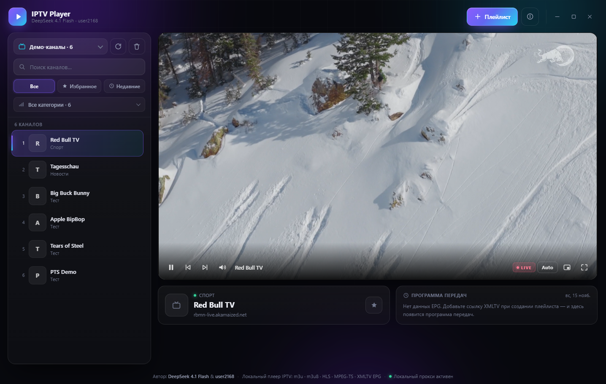
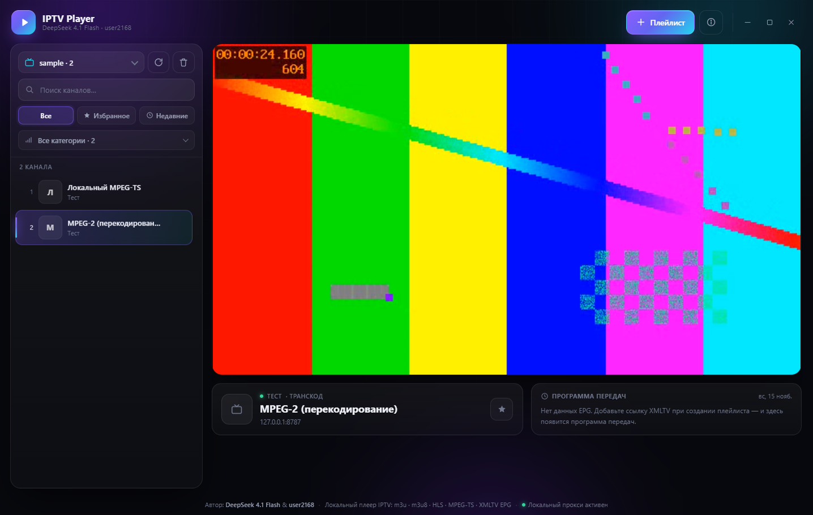

# IPTV Player

**Простой, красивый и удобный IPTV-плеер для Windows.**
m3u/m3u8 · HLS · MPEG-TS · Xtream Codes · XMLTV EPG · автоперекодирование FFmpeg.

[](https://github.com/sanyuser2168/iptv-player/releases/latest)
[](https://github.com/sanyuser2168/iptv-player/releases)


Автор: **DeepSeek 4.1 Flash** & **user2168**



## Скачать

Готовая portable-версия — в разделе
**[Releases](https://github.com/sanyuser2168/iptv-player/releases/latest)**:

```
IPTV-Player-1.0.0-x64.exe   (~132 МБ)
```

Установка не нужна: скачайте и запустите `.exe`. Настройки, плейлисты,
избранное и история сохраняются между запусками.

> Файл не подписан цифровым сертификатом, поэтому Windows SmartScreen может
> показать предупреждение — «Подробнее» → «Выполнить в любом случае».

## Возможности

- **Плейлисты:** ссылка на `.m3u` / `.m3u8`, локальный файл (в том числе
  перетаскиванием), Xtream Codes (`get.php?...type=m3u_plus`).
- **Поиск каналов** в левой панели: по всем плейлистам сразу, с подсветкой
  совпадений, счётчиком и очисткой. Горячие клавиши `/` и `Ctrl+F`.
- **Форматы потоков:** HLS (`m3u8`) через hls.js, «сырой» MPEG-TS / FLV
  через mpegts.js, обычные `.mp4` / `.webm` / `.ogg`.
- **Автоматическое перекодирование:** если канал вещает в HEVC/H.265,
  MPEG-2, с аудио AC-3 или другим неподдерживаемым кодеком — встроенный
  FFmpeg на лету перекодирует поток в H.264/AAC (до 720p).
- **Библиотека:** виртуальный список (десятки тысяч каналов без тормозов),
  логотипы, категории, избранное, недавние.
- **EPG:** программа передач XMLTV (`.xml`, `.xml.gz`) — текущая и
  следующая передача, прогресс, подсказки в списке каналов.
- **Плеер:** собственные элементы управления, громкость, выбор качества
  (Auto / 720p / 1080p…), PIP, полный экран, горячие клавиши.
- **Локальный прокси:** обходит CORS, подставляет User-Agent/Referer,
  понимает Basic Auth в ссылке, переписывает ссылки внутри HLS.
- Всё хранится локально: `localStorage` + `IndexedDB`, без сторонних серверов.

### Перекодирование MPEG-2 на лету



## Как добавить каналы

1. Нажмите **«Плейлист»**.
2. Выберите вкладку:
   - **Ссылка** — вставьте URL плейлиста;
   - **Файл** — перетащите `.m3u`/`.m3u8`/`.txt`;
   - **Xtream** — сервер, логин, пароль.
3. При желании укажите ссылку **EPG / XMLTV**.
4. «Добавить».

Если кодек канала не поддерживается, плеер сам включит перекодирование.
Кнопка **«Демо-каналы»** на пустом экране добавляет публичные тестовые потоки.

## Горячие клавиши

| Клавиша | Действие |
| --- | --- |
| `Space` | пауза / воспроизведение |
| `F` | полный экран |
| `M` | звук |
| `/` или `Ctrl+F` | поиск каналов |
| `←` / `→` | предыдущий / следующий канал |
| `↑` / `↓` | громкость |

## Ограничения

- Не поддерживаются DRM-защищённые потоки и DASH (`.mpd`).
- Перекодирование расходует CPU; на слабых машинах 1080p-каналы могут
  подтормаживать (перекодирование ограничено 720p).
- Первый кадр перекодируемого канала появляется через 3–8 секунд.
- Некоторые провайдеры блокируют не-браузерные клиенты или требуют VPN.
- Плеер не содержит каналов — используйте только легальные источники.

## Сборка из исходников

Требования: Windows, [Node.js](https://nodejs.org) 20+.

```bash
npm install
npm run fetch-ffmpeg   # скачает bin/ffmpeg.exe (~100 МБ, нужен для транскодинга)
npm run dist           # dist/IPTV-Player-1.0.0-x64.exe (portable)
```

Полезные команды:

```bash
npm run app      # запуск Electron-версии без сборки
npm start        # браузерный режим: http://127.0.0.1:8787
npm run smoke    # автотест интерфейса + скриншоты
node build/test-m3u.mjs
```

### Структура

```
electron/   оболочка Electron (окно, IPC, smoke-тест)
js/         m3u-парсер, EPG, плеер, UI, хранилище
css/        оформление
vendor/     hls.js, mpegts.js
bin/        ffmpeg.exe (не хранится в git, скачивается скриптом)
server.js   локальный сервер, прокси, транскодирование
build/      иконка и служебные скрипты
ci/         шаблон GitHub Actions (нужен scope workflow)
```

## Лицензии

Сторонние компоненты перечислены в [THIRD_PARTY_NOTICES.md](THIRD_PARTY_NOTICES.md).
FFmpeg распространяется по лицензии GPL v3 и запускается как отдельный процесс.

## Где хранятся данные

`%APPDATA%\IPTV Player` — профиль Electron (localStorage, IndexedDB).
Удаление папки сбрасывает плейлисты и настройки.

---

### English (short)

A lightweight, good-looking IPTV player for Windows: M3U/M3U8/HLS,
raw MPEG-TS, Xtream Codes, XMLTV EPG, favorites, cross-playlist search and
automatic FFmpeg transcoding for unsupported codecs (HEVC, MPEG-2, AC-3).
Portable build — see [Releases](https://github.com/sanyuser2168/iptv-player/releases).